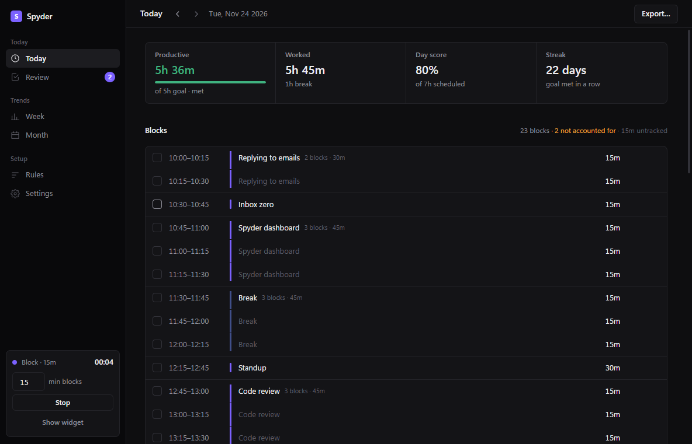

# Spyder

A personal Windows app that holds you accountable for your working time.

Most time trackers quietly log what you did. Spyder is stricter: you press **Start**, and every 15 minutes (or whatever block length you pick) it asks **what did you do?**, then the next block starts. Your working day becomes a list of equal blocks, each saying where the time went.

No accounts, no cloud and no AI. Everything stays in a local SQLite file on your machine.




<sub>Screenshots show made-up sample data.</sub>

## What it does

- **The block loop.** Press Start in the dashboard with a block length (5–180 minutes). When a block ends, the next one starts at once and a prompt asks what the last one was: type it, press **Break** (anything you typed is kept as the break's answer), or **Same as last**. Missed a few? They're all in one prompt.
- **Nothing starts by itself.** During work hours with no loop running, the bar says *Not started* and a reminder pops up every block length. The loop stops at the end of work hours (*Keep working* carries on).
- **Floating widget.** A small always-on-top bar shows the time in the current block, today's productive time and how much of the workday has passed. It turns red when you're distracted.
- **Fix the record.** On Today, re-answer any block, give many blocks one answer, delete blocks (their time becomes untracked) or merge adjacent ones into one longer block, all with Undo.
- **Work or break.** Every block is tagged Work or Break, separate from its answer. Change a tag from the dropdown on each row, or for many blocks at once. Work blocks use a colour you pick in Settings (green by default); breaks are blue-grey.
- **App and website tracking.** It records the foreground app every 2 seconds, Chrome sites from the address bar and Firefox sites from the window title. No browser extensions needed.
- **Categories and nudges.** Apps and sites are Productive, Neutral, Distracting or Uncategorized, based on editable rules. After 5 straight minutes on something distracting while the loop runs, you get a gentle nudge. Nothing is ever blocked.
- **Reports.**
  - **Today:** your productive time against your goal, a timeline and your top apps.
  - **Week:** stacked bars per day.
  - **Month:** a heatmap and trend lines.
- **End-of-day review.** When work hours end, you answer any blocks still not accounted for, see a pie chart of where the day went (work, break, not accounted for, untracked), write *Today's wins* and *How I'll improve*, and record your own daily numbers (KPIs). Meeting your goal on consecutive workdays builds a streak.
- **Export.** Any date range goes out to one `.xlsx` workbook plus matching CSVs.

## Privacy

Spyder makes no network requests. Nothing leaves your machine unless you export it yourself.

What it stores, in `%APPDATA%\Spyder\spyder.db`:

- **The foreground app every 2 seconds**: its exe name, app name and **window title**. Window titles often contain document names, email subjects and page titles.
- **Websites**: for Chrome and Edge, the site's domain from the address bar (not the full URL). For Firefox, the page title and site, parsed from the window title.
- **Private windows**: Firefox private windows are stored as *Private browsing*, with no title or site. **Chrome Incognito and Edge InPrivate windows can't be reliably told apart from normal ones, so they are recorded like any other window** ([ADR-0007](docs/adr/0007-browser-site-detection.md)).
- What you type: block answers, review notes and KPI values.

Nothing is recorded while you're away (idle, locked or asleep). Spyder starts with Windows (turn it off in Settings). Uninstalling keeps your data. To delete it, quit Spyder and delete the `%APPDATA%\Spyder` folder.

## Getting started

You need **Windows 10/11** and **Node.js 22.13 or newer** (`node:sqlite` is used; development was done on Node 25).

```powershell
git clone https://github.com/perplexingpasta/spyder.git
cd spyder
npm install
npm run build:helper   # builds the small Chrome address-bar reader (uses Windows' own C# compiler)
npm run dev            # starts the app with hot reload
```

> `npm run dev` uses your real data folder (`%APPDATA%\Spyder`). To experiment without touching it, set a throwaway folder first:
> `$env:SPYDER_DATA_DIR = "$env:TEMP\spyder-test"; npm run seed; npm run dev`

**Build an installer:** `npm run dist` writes `release/Spyder Setup <version>.exe`. This is a per-user install that starts with Windows. Uninstalling keeps your data.

The installer is **not code-signed**, so Windows SmartScreen warns about it ("Windows protected your PC"). Choose **More info → Run anyway**, or build it yourself from source.

> The first `npm run dist` downloads Electron (~110 MB) and a few packaging tools from GitHub releases. On networks where GitHub release downloads crawl, it can fail with `Timeout awaiting 'request' for 600000ms`. Point both downloads at a mirror and run it again. Each file is still checked against its known checksum.
> ```powershell
> $env:ELECTRON_MIRROR = "https://npmmirror.com/mirrors/electron/"
> $env:ELECTRON_BUILDER_BINARIES_MIRROR = "https://npmmirror.com/mirrors/electron-builder-binaries/"
> npm run dist
> ```

**Shortcuts:** `Ctrl+Alt+S` shows or hides the widget. The tray icon has everything else.

## Commands

| Command | What it does |
|---|---|
| `npm run dev` | Run the app in development mode |
| `npm run typecheck` / `npm run lint` | Type-check and lint |
| `npm test` | Unit tests (Vitest) for the core logic |
| `npm run test:e2e` | Build, then run the end-to-end tests (Playwright driving Electron) |
| `npm run seed` | Fill `SPYDER_DATA_DIR` with realistic sample days |
| `npm run db:dump` | Print what's in the database |
| `npm run dist` | Build the Windows installer |
| `npm run install:local` | **Maintainer only.** Builds the installer, force-quits the running Spyder, installs over it silently and restarts it. The opt-in post-commit hook (`git config core.hooksPath .githooks`) runs it after every commit on `main`; contributors shouldn't turn that on |

## How it's built

```
src/core/      Pure TypeScript: block engine (a reducer), schedule, nudges, categories, reports
src/main/      Electron main process: runs the engine, idle detection, app/site capture, SQLite, export
src/preload/   The window.spyder API the UI talks through
src/renderer/  React UI: widget, prompt window and dashboard (one bundle, hash routes)
src/native/    UrlHelper.cs, which reads Chrome's address bar via UI Automation
tests/e2e/     Playwright tests against the built app
```

The core logic never reads the real clock. Time is passed in, so tests can run a whole workday in seconds (`SPYDER_CLOCK_SCALE`, `SPYDER_NOW`).

## Documentation

| File | Read it for |
|---|---|
| [`CONTEXT.md`](CONTEXT.md) | The vocabulary: block, loop, answer, untracked, nudge, review… |
| [`docs/product-decisions.md`](docs/product-decisions.md) | Every behavior decision and why it was made |
| [`docs/adr/`](docs/adr/) | Architecture decisions (why Electron, why `node:sqlite`, why no AI, …) |
| [`SPYDER_PLAN.md`](SPYDER_PLAN.md) | The full original spec and the build log |
| [`design/DESIGN.md`](design/DESIGN.md) | Visual design: colors, type, widget and page layouts |
| [`AGENTS.md`](AGENTS.md) | Orientation for AI coding agents working on the repo |

## Contributing and security

See [`CONTRIBUTING.md`](CONTRIBUTING.md). To report a vulnerability, see [`SECURITY.md`](SECURITY.md); please don't open a public issue.

## Credits

The Windows capture techniques are adapted from [OpenTime](https://github.com/ElectricGamer61/OpenTime) (Apache-2.0). See [`NOTICE`](NOTICE). The look of the widget was inspired by Rize; none of its branding is used.

## License

[MIT](LICENSE)
